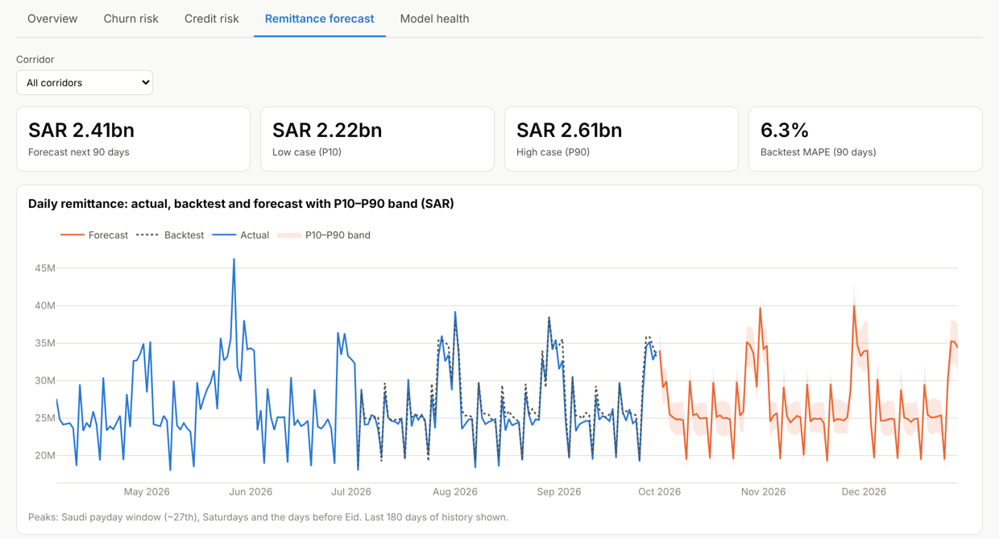
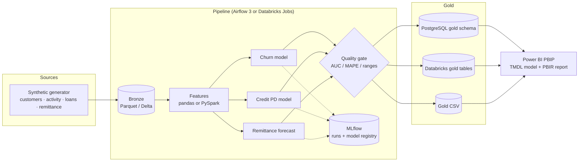

# Bank Predictive Analytics — from Python models to a Power BI report

End-to-end predictive analytics for a (synthetic) Saudi retail bank. Three models are trained, validated, tracked and scored by a scheduled pipeline, and the results land in a gold layer that a Power BI project (PBIP) reads directly.

| Use case | Question it answers | Model | Validation (latest run) |
|---|---|---|---|
| **Customer churn** | Which active customers are likely to leave in the next 3 months, and why? | Gradient boosting on 6-month behaviour snapshots | Out-of-time AUC **0.82**, top-decile lift **5.3×** |
| **Credit risk** | What is each live loan's 12-month probability of default and expected loss? | Champion/challenger: logistic scorecard vs gradient boosting | Out-of-time AUC **0.80** (scorecard won; GBM 0.76) |
| **Remittance forecast** | How much will customers send per corridor over the next 90 days? | Log-linear trend + gradient-boosted calendar effects, P10–P90 band | 90-day backtest MAPE **6.1%** |

The same Python package runs in three places: a laptop, a local **Airflow 3 + MLflow + PostgreSQL** stack in Docker, and **Databricks** (PySpark + Unity Catalog). Power BI switches between them with one parameter.

> All data is generated by `bpa.generate_data`. No real customer data is used anywhere.

**Live demo:** https://vickarzz.github.io/bank-predictive-analytics/ — interactive, no login, runs entirely in the browser



---

## Architecture



The quality gate runs **before** the database load, so a bad model run never reaches the report — Power BI simply keeps yesterday's data.

## Repository layout

```
├── src/bpa/                    # shared Python package (used by every runtime)
│   ├── generate_data.py        # synthetic bronze data with planted, learnable patterns
│   ├── churn.py                # snapshot features, OOT validation, scoring, reason codes
│   ├── credit_risk.py          # PD champion/challenger, risk grade, EL = PD x LGD x EAD
│   ├── remittance_forecast.py  # trend + calendar model, P10/P90, 90-day backtest
│   ├── spark_features.py       # PySpark version of the churn features (parity-tested)
│   ├── tracking.py             # MLflow wrapper (never blocks the pipeline)
│   ├── io.py                   # Parquet/CSV + PostgreSQL COPY loader with atomic swap
│   └── pipeline.py             # CLI: generate | churn | credit | forecast | publish | all
├── dags/                       # Airflow 3 DAG (also runs on Airflow 2)
├── docker/                     # docker-compose: Postgres 16, MLflow server, Airflow 3
├── databricks/                 # notebooks 00-06 + job definition
├── databricks.yml              # Databricks Asset Bundle
├── powerbi/
│   ├── build_pbip.py           # generates the PBIP from a Python spec (report-as-code)
│   ├── BankPredictive.pbip     # ← open this in Power BI Desktop
│   ├── BankPredictive.SemanticModel/   # TMDL: 10 tables, 30 measures, 9 relationships
│   └── BankPredictive.Report/          # PBIR: 5 pages, 53 visuals
├── docs/index.html             # public live demo on GitHub Pages (built by tools/build_static_demo.py)
├── streamlit_app/              # same demo as a Streamlit app (optional)
├── tests/                      # pipeline contract, Power BI contract, Spark parity
└── docs/model_card.md
```

---

## Quick start

### Option A — Python only (about 1 minute), then Power BI

```bash
python -m venv .venv
# Windows: .venv\Scripts\activate      macOS/Linux: source .venv/bin/activate
pip install -r requirements.txt
pip install -e .

python -m bpa.pipeline all          # writes data/bronze, data/silver, data/gold
pytest -q                           # 17 tests
mlflow ui --backend-store-uri sqlite:///data/mlflow.db   # optional: http://127.0.0.1:5000
```

Then open `powerbi/BankPredictive.pbip` (see [Power BI](#power-bi) below).

Scale it up: `BPA_N_CUSTOMERS=500000` produces about 12 million monthly activity rows.

### Option B — Local production-like stack (Docker)

```bash
echo "AIRFLOW_UID=$(id -u)" > docker/.env          # Linux only
docker compose -f docker/docker-compose.yml up -d --build
```

| Service | URL | Notes |
|---|---|---|
| Airflow 3 | http://localhost:8080 | DAG `bank_predictive_pipeline`, daily 05:00 Riyadh time. Trigger it once manually. |
| MLflow | http://localhost:5000 | Experiments plus registered models `bpa-churn` and `bpa-credit_risk` |
| PostgreSQL | `localhost:5432`, db `bpa`, schema `gold` | Power BI login: `powerbi_reader` / `powerbi_reader` (read-only) |

DAG: `generate_bronze → [score_churn, score_credit_risk, forecast_remittance] → quality_gate → publish_gold`

The gold load uses PostgreSQL `COPY` into a staging table and then swaps tables in one transaction. That loads 1.2M rows in about 10 seconds, and Power BI never reads a half-loaded table.

### Option C — Databricks (Free Edition works)

**Simplest:** in the workspace, go to *Workspace → Create → Git folder*, paste your repo URL, then run notebooks `00` to `06` in `databricks/notebooks/` in order.

**As a scheduled job (Asset Bundle):**

```bash
databricks auth login --host https://<your-workspace>.cloud.databricks.com
databricks bundle deploy -t dev
databricks bundle run bank_predictive_pipeline -t dev
```

What runs on Databricks:
- Churn features are built with **PySpark** in one distributed pass over all snapshots.
- Models are tracked in MLflow and **registered in Unity Catalog** (`workspace.bpa.churn`, `workspace.bpa.credit_risk`) with signatures.
- Scoring uses `mlflow.pyfunc.spark_udf`.
- Gold tables are written as Delta with the same names as the PostgreSQL gold schema.

---

## Power BI

1. Open `powerbi/BankPredictive.pbip` in Power BI Desktop. Enable *Options → Preview features → Power BI Project (.pbip) save option* and *Store reports using enhanced metadata format (PBIR)* if your version still lists them.
2. Go to *Transform data → Edit parameters* and set:

| Parameter | CSV (Option A) | PostgreSQL (Option B) | Databricks (Option C) |
|---|---|---|---|
| `SourceType` | `CSV` | `PostgreSQL` | `Databricks` |
| `CsvFolder` | `C:\...\bank-predictive-analytics\data\gold\` (keep the trailing `\`) | – | – |
| `PgServer` / `PgDatabase` | – | `localhost:5432` / `bpa` | – |
| `DbxServerHostname` / `DbxHttpPath` | – | – | from *SQL Warehouse → Connection details* |
| `DbxCatalog` / `DbxSchema` | – | – | `workspace` / `bpa` |

3. Click **Refresh**.

**Report pages**

| Page | What it shows |
|---|---|
| Executive Overview | KPIs across all three models, balance at risk by segment, expected loss by grade, remittance actual vs forecast |
| Churn Risk | Risk distribution by decile, early-warning signals, a retention worklist sorted by churn probability |
| Credit Risk | EAD and EL by grade, PD by DBR band (SAMA-style affordability), loan watchlist |
| Remittance Forecast | Actual, backtest and forecast with P10–P90 band per corridor, weekday pattern |
| Model Health | Out-of-time AUC, Gini, backtest MAPE, permutation feature importance |

**Semantic model:** star schema with `Customer`, `Date` (marked as date table, Sunday-first week) and `Corridor` dimensions, plus six fact tables. `Loan Risk[Origination Date]` is an inactive relationship used through `USERELATIONSHIP` in **Loans Originated**.

The PBIP is generated by `python powerbi/build_pbip.py`. Every JSON file validates against Microsoft's published PBIR schemas, and every Power Query (M) expression parses with Microsoft's `powerquery-parser`. Desktop may still re-format some files the first time you save. That is expected: commit the re-saved version.

---

## Live demo

**https://vickarzz.github.io/bank-predictive-analytics/** is a static page served by GitHub Pages: five tabs (overview, churn, credit, remittance, model health), filters, a retention worklist and a credit watchlist. The gold sample (20k customers) is embedded in the page, so there is no server and nothing to wake up.

```bash
python tools/build_static_demo.py                    # rebuild docs/index.html from streamlit_app/demo_data
python tools/build_static_demo.py --gold data/gold   # or from your own pipeline run
```

The same views also exist as a Streamlit app (`streamlit run streamlit_app/streamlit_app.py`) for anyone who prefers to run it locally. Deployment steps are in [docs/DEPLOY.md](docs/DEPLOY.md).

## Design decisions worth discussing in an interview

- **Out-of-time validation everywhere.** Churn trains on older monthly snapshots and tests on the latest labelled one. Credit risk tests on the newest 25% of originations. Remittance is backtested on the last 90 days. Random splits would overstate performance.
- **Honest champion/challenger.** The simpler logistic scorecard beat gradient boosting on out-of-time AUC, so it is the champion. Ties within 0.005 AUC also go to the scorecard because it is easier to explain to credit committees and regulators.
- **Fair-lending hygiene.** Customer type, age and region are excluded from the credit model.
- **Reason codes.** Each churn score has a `primary_signal` (salary transfer stopped, complaints, falling digital engagement, …) so front-line teams know what to say, not just whom to call.
- **Business units, not just probabilities.** The pipeline outputs expected churners, balance at risk, EAD, expected loss and P10/P90 cash-flow bands.
- **Pipeline never depends on MLflow being up.** Tracking failures are logged and models are still saved.
- **One codebase, three runtimes.** pandas and PySpark feature builders are checked against each other by `tests/test_spark_parity.py`.
- **Contracts between layers.** Tests assert that every column the Power BI model reads exists in the gold output, and that every DAX and visual field reference resolves.

## Known limitations and next steps

- **Synthetic data.** Patterns are planted, so metrics show the method works, not real-world performance.
- **P10–P90 coverage is 73%** against a nominal 80%. Conformal calibration of the quantile models is the next step.
- **Churn score calibration.** Add isotonic calibration and a monitoring page for population stability (PSI) and drift.
- **Row-level security** by region, and incremental refresh on `Customer Monthly`.

## Testing

```bash
pytest -q                                  # pipeline + Power BI contract tests
pip install pyspark && pytest tests/test_spark_parity.py
```

---

Author: **Ahmad Zulfikar Rafsanjani** · [github.com/vickarzz](https://github.com/vickarzz) · MIT License
